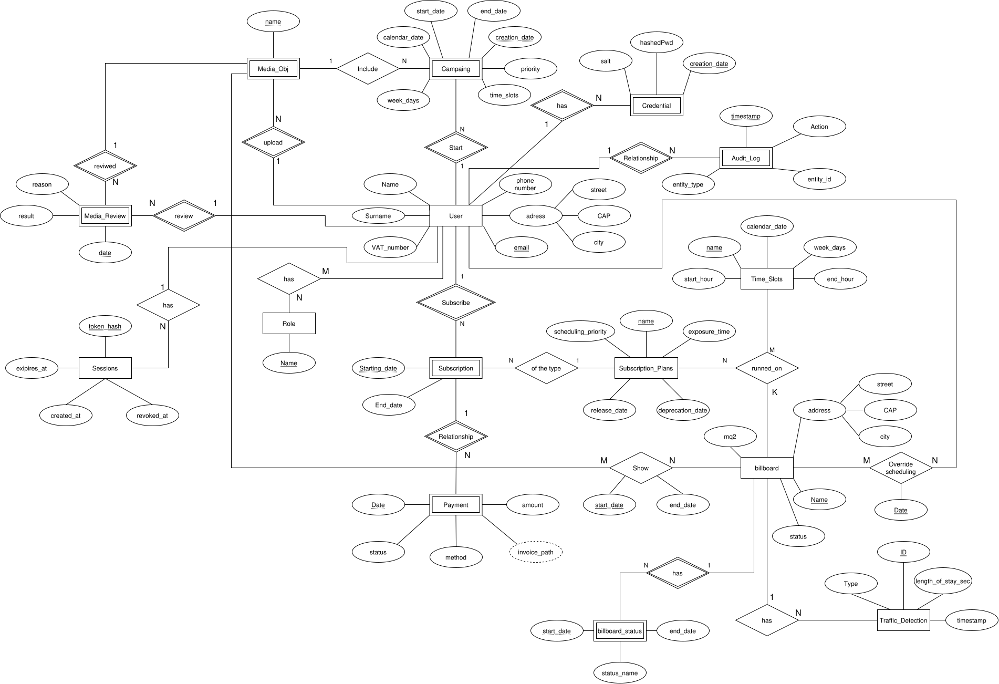

# PiazzAD
We propose this solution to managing and purchasing
advertising space on digital billboards.

## 1. Project Overview
PiazzAD aims to connect advertiser with digital billboards
through a web-based application.

The platform is designed to:
- User authentication and role managment.
- Billboards registrations and managment.
- Advertsing Campaign creation and scheduling.
- Advertisement review and approval.
- Order and payment managment.
- Invoice managmnet.
- Advertising statistics.
- Show Pedestrian and veichle traffic analytics.
- Auto Advertisement scheduling.
- Administrative operation.

## 2. Technology Stack
### Backend:
    Python
    FastAPI
    SQLAlchemy
    Alembic

### Database:
    PostgreSQL

### Frontend:
    HTML
    CSS
    JavaScript
    Bootstrap

### Communication Protocols:
    HTTPS
    #TODO aggiungere protoccolo per communicazione con cartellone

### Dev Tools:
    Git
    GitHub

## 3. Architeture
#TODO

## 4. User Roles
Our system is based on different user roles, to 
suit the minimum responsability principle:

- Advertiser: creates and manages advertising campaigns.
- Moderator: Review and approves advertisements.
- Fiscal Staff: Manages the financial side of the application.
- Admin: Manages the whole platform.

## 5. Database
We design the following E/R diagram for the database:

## 6. Installation
#TODO

## 7. Thanks
